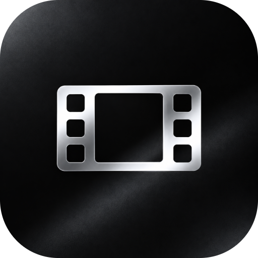

  

<h1 align="center">TorrFrame</h1>

  <strong>Фильмы, сериалы и торренты на Android TV</strong> 
  Выбирайте фильм, находите раздачу и смотрите — с пульта телевизора или телефона.

  <a href="https://github.com/HolyMayhem/TorrFrame/releases">Скачать APK</a>
  &nbsp;·&nbsp;
  <a href="#установка">Установка</a>
  &nbsp;·&nbsp;
  <a href="#phone-remote">Phone Remote</a>
  &nbsp;·&nbsp;
  <strong>Русский</strong> · <a href="README.en.md">English</a>

  
  
  
  

---

Выберите фильм или сериал, найдите раздачу и запустите просмотр во встроенном плеере. TorrFrame объединяет каталог, поиск торрентов, сохранённые фильмы и вашу медиатеку на большом экране.

**TorrServer уже встроен.** Он запускается автоматически — компьютер и отдельная установка сервера не нужны. При желании можно подключить свой TorrServer.

## Возможности

| | Что можно делать |
| --- | --- |
| **Каталог фильмов и сериалов** | Выбирать фильмы по обложкам, описаниям, рейтингам, жанрам и похожим названиям. |
| **Поиск раздач** | Искать через TorrentSearch или подключить свой Jackett для дополнительных источников. |
| **Избранное и «Смотреть позже»** | Сохранять интересные фильмы и при желании выводить эти подборки на главную страницу каталога. |
| **Ваша медиатека** | Открывать добавленные в TorrServer раздачи и выбирать нужный фильм или серию. |
| **Встроенный плеер** | Перематывать, переключать дорожки и субтитры, менять скорость и продолжать с места остановки. Можно выбрать установленный внешний плеер. |
| **Phone Remote** | Листать каталог, искать фильмы, добавлять magnet-ссылки и управлять просмотром из браузера телефона. |
| **Мастер первого запуска** | Выбрать язык, оформление, управление с телефона и сервер за четыре коротких шага. |
| **Оформление на ваш вкус** | Русский и английский языки, светлая и тёмная темы, акцентные цвета, масштаб, анимации и отключаемые звуки. |

## Установка

**Нужны Android TV 8.0 или новее, устройство ARM64 или ARMv7 и интернет.** Для управления подойдёт пульт со стрелками, кнопками OK и «Назад».

1. Скачайте **APK-файл TorrFrame** из раздела [Releases](https://github.com/HolyMayhem/TorrFrame/releases).
2. Перенесите его на телевизор или приставку по локальной сети либо на флешке.
3. Откройте APK через файловый менеджер на приставке и установите приложение.
4. Запустите **TorrFrame** из списка приложений.

> [!NOTE]
> Если Android попросит, разрешите файловому менеджеру установку приложений из этого источника.

Для обновления TorrFrame установите новый APK поверх существующего приложения, не удаляя его заранее. При обычном обновлении настройки и медиатека сохраняются. Встроенный TorrServer обновляется вместе с приложением.

## Первый запуск

Мастер настройки поможет выбрать язык и оформление, подключить телефон и указать TorrServer. Его можно пропустить и сразу перейти к приложению.

По умолчанию выбраны **русский язык**, **включённый Phone Remote** и **отключённые подсказки по навигации**. Всё это можно изменить позже. Повторно открыть мастер можно в **«Настройки → О приложении → Мастер первоначальной настройки»**.

## Как начать смотреть

**Каталог → выберите фильм → TorrentSearch → выберите раздачу → смотрите.**

Если в раздаче несколько видеофайлов, выберите нужный фильм или серию. Добавленные раздачи появятся в **«Медиатеке»** — это материалы, добавленные в ваш TorrServer, а не все фильмы из каталога. Для начала просмотра не нужно ждать полной загрузки торрента.

Сердечко в карточке добавляет фильм в **«Избранное»**, а значок часов — в **«Смотреть позже»**. Оба списка доступны из каталога и медиатеки. Их полки на главной странице можно скрыть в **«Настройки → Каталог»**.

| Кнопка пульта | Действие |
| --- | --- |
| **Стрелки** | Перемещение между элементами. |
| **OK** | Выбор или открытие элемента. |
| **Назад** | Возврат на предыдущий экран. |
| **Удержание OK на обложке каталога** | Меню действий с фильмом. |
| **Удержание OK на вкладке «Каталог»** | Возврат на главную страницу каталога. |

## Phone Remote

Печатайте на телефоне вместо ввода каждой буквы телевизионным пультом. Ищите фильмы, вставляйте magnet-ссылки, управляйте медиатекой и встроенным плеером. **Устанавливать приложение на телефон не нужно.**

1. Подключите телефон и приставку к **одной домашней сети**.
2. Нажмите значок телефона в шапке приложения или откройте **«Настройки → Phone Remote»**.
3. Отсканируйте QR-код. Также можно открыть указанный адрес в браузере и ввести код подключения с экрана.

На телефоне четыре вкладки: **«Поиск»**, **«Медиатека»**, **«Пульт»** и **«Настройки»**. Медиатека, избранное и просмотр позже общие с телевизором. Язык телефонного интерфейса переключается отдельно.

Управление воспроизведением работает со встроенным плеером TorrFrame. Возможности внешнего плеера зависят от выбранного приложения.

## Каталог и поиск

По умолчанию выбран **TMDB**. В **«Настройки → Каталог»** можно выбрать **CUB** или **автоматический режим**. Автоматический режим сначала использует TMDB, а при ошибке загрузки подборок или поиска пробует CUB. Аккаунт CUB не нужен.

Полные карточки и похожие фильмы при любом выборе источника используют TMDB. Для изображений предусмотрены отдельные запасные адреса. Доступность каталога и обложек зависит от доступа к этим сервисам из вашей сети.

Чтобы пользоваться своим [Jackett](https://github.com/Jackett/Jackett), включите его в **«Настройки → Jackett»** и укажите адрес и API-ключ. После этого в карточках фильмов появится его кнопка поиска. Jackett подключать необязательно: TorrentSearch работает самостоятельно.

Наличие раздач и скорость просмотра зависят от источников поиска, вашего подключения и участников, раздающих файл.

## Оформление и звуки

В **«Настройки → Оформление»** можно изменить язык, тему, акцентный цвет, масштаб интерфейса и анимации.

Тихие звуки интерфейса и сопровождение заставки отключаются переключателем **«Звуки интерфейса»**. Звук фильмов и сериалов регулируется отдельно.

## Благодарности

TorrFrame — независимое приложение, использующее [TorrServer](https://github.com/YouROK/TorrServer), данные [TMDB](https://www.themoviedb.org/), публичный каталог [CUB](https://tmdb.cub.best/) и наработки [TorrentSearch](https://github.com/prajwalch/TorrentSearch).

Спасибо авторам и участникам этих проектов. У проектов и сервисов собственные условия использования и лицензии. Лицензии сторонних компонентов доступны в **«Настройки → О приложении»**.
